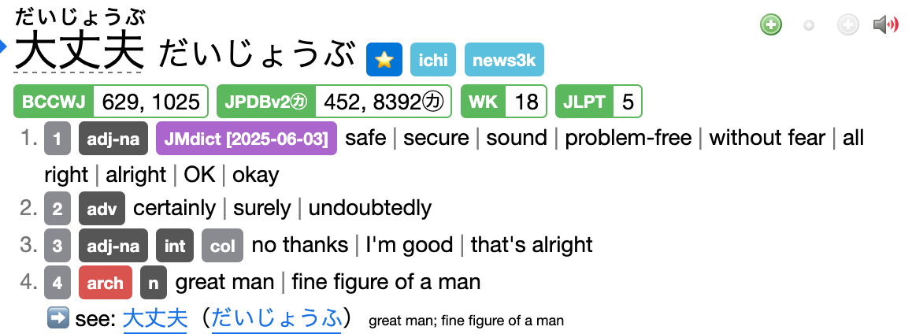
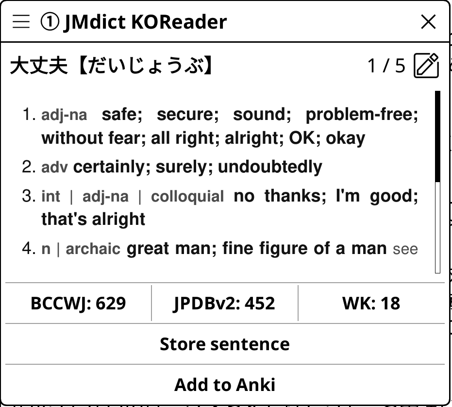

# More Yomitan-like JMDict & JMNEDict Stardict for KOReader

This repository is part of [*ImmersionKit*](https://github.com/UnexpectedTiramisu/immersionkit), a collection of tools to aid language learning through KOReader and Anki.

The dictionary built by this tool is the dictionary expected by the [dictionarymeta.koplugin](https://github.com/UnexpectedTiramisu/immersionkit-koreader-dictionary-meta-information), which is also a part of *ImmersionKit*.

This repository contains a tool that will download the latest JMDict and JMNEDict (see www.edrdg.org/jmdict/j_jmdict.html) files,
then convert them to the StartDict format with some styling to make the content of a dictionary popup seem more like the [Yomitan]() desktop addon.

A core part of this, apart from the css in `renderer.py`, is `yomitan_sense_remapper.py`,
which provides Yomitan's abbreviations (e.g. "n" for noun) for classifications in JMDict.
The tag implementation used as a guideline is that of *yomitan-import*, which can be viewed [here](https://github.com/yomidevs/yomitan-import/blob/main/jmdict_tags.go).

Another important note is that when compared to other Stardict versions JMDict for KOReader,
this tools flips the word / reading order (i.e. word, then reading).

Please see the comparison of desktop Yomitan and the built Stardict below.

## Download the Stardict files

Please note that the frequency information is **NOT** baked into the Stardict.

The frequency information is provided by a separate KOReader plugin, which is also a part of [ImmersionKit](https://github.com/UnexpectedTiramisu/immersionkit)

Please find the plugin here: https://github.com/UnexpectedTiramisu/immersionkit-koreader-dictionary-meta-information

## Attribution & License

This tool makes use of JMDict and JMNEDict, which are provided by the *Electronic Dictionary Research and Development Group* (https://edrdg.org)
under the Creative Commons Attribution-ShareAlike License (V4.0). See https://www.edrdg.org/edrdg/licence.html.

The resulting work is therefore distributed under the same license.